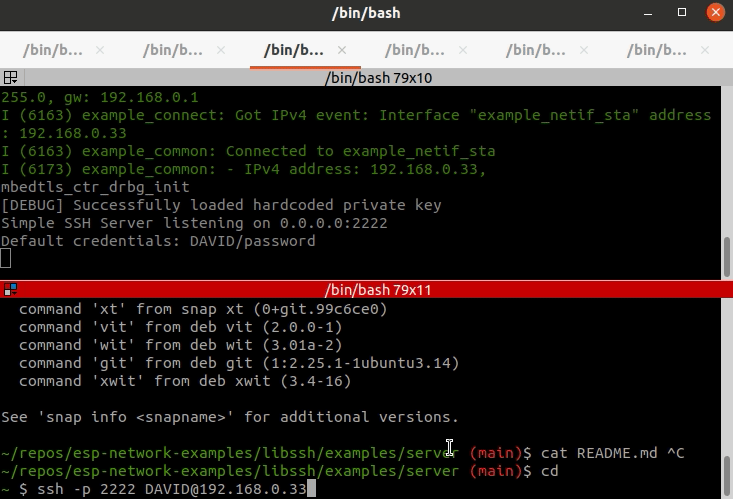

# libssh

Embedded ports of [libssh](https://www.libssh.org/) so you can run `sshd` on your device and SSH into it.

Supported platforms:

- **[ESP-IDF](libssh/README.md)** — ESP32-class devices
- **[Zephyr](zephyr/README.md)** — Zephyr RTOS boards

